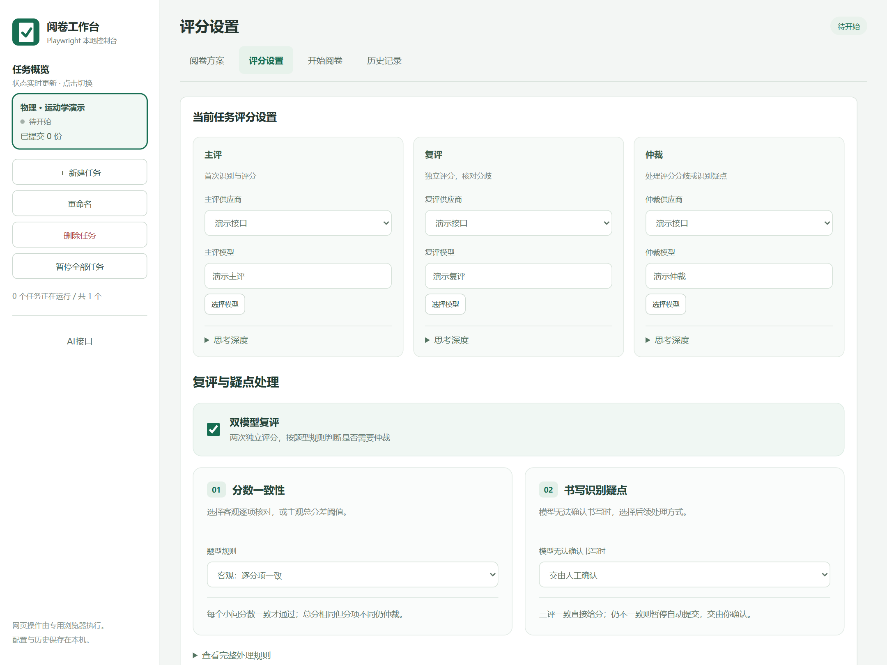
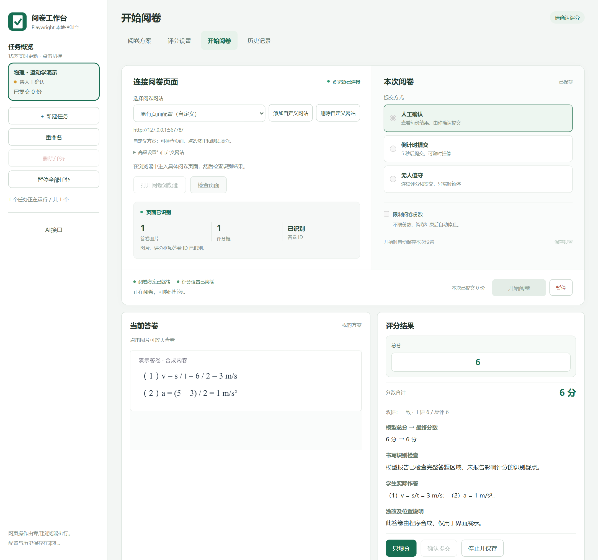
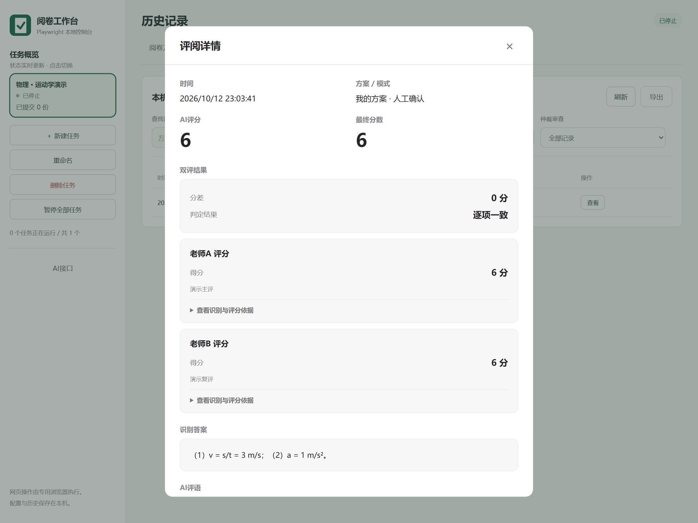

# AI-Marker-Playwright · AI阅卷工作台

面向教师的本地可视化 AI 阅卷软件，当前推荐下载 `v2026.10.19-beta1` Beta 版。按“阅卷方案 → 评分设置 → 开始阅卷”完成配置，支持模型评分、双评仲裁、人工确认、连续阅卷、历史导出与独立并发任务。

[下载 Windows Beta 版](https://github.com/shimingzhi0017/AI-Marker-Playwright/releases/download/v2026.10.19-beta1/AI-Marker-Playwright-beta.exe) · [Beta 发布说明](https://github.com/shimingzhi0017/AI-Marker-Playwright/releases/tag/v2026.10.19-beta1) · [测试报告](测试报告.md) · [验证与待办](验证与待办.md)

## 下载与使用

> 当前首页推荐下载的是 `v2026.10.19-beta1` Beta 版。旧版 `v2026.10.12` 已不再推荐使用；如果浏览器仍显示旧下载地址，请刷新 GitHub 首页缓存后再点击上面的直链。

| 版本 | 使用方式 |
| --- | --- |
| 单文件 EXE | 在发布页下载 EXE，双击启动；当前构建约250 MB（随 Chromium 版本变化），首次启动等待解压，内置 Node.js、Chromium 及依赖 |
| 便携 ZIP | 下载后全部解压，双击“启动工作台.cmd”；无需另装Node.js，内置浏览器受限时尝试本机Edge |
| 源码版 | 适合开发及修改，按下方“源码安装环境”准备Node.js并启动 |

EXE未签名，部分Windows应用控制策略可能阻止运行，可使用便携版入口。两种发布版选择一个启动。发布包不含个人API密钥、任务、答卷、历史或登录资料；首次使用需配置自己的AI接口和阅卷方案。发布版个人资料保存在 `%LOCALAPPDATA%\AI-Marker-Playwright\user-data`，关闭后保留。

## 当前功能

- 阅卷方案：文本、图片上传与粘贴，公式排版预览；AI根据九学科、三档宽严、给分方式与本题补充生成评分标准，统一总分、分项和步长。
- 评分设置：单评仅调用主评；双评主评与复评并行，客观题按标准逐项比对，主观题按总分差阈值处理，需要时独立仲裁。
- 开始阅卷：网站模板及自定义适配调试、页面检查、人工确认、5秒倒计时、无人值守、可选份数限制及暂停。
- 任务与历史：独立任务实时状态、共享AI接口、图片与分项详情、仲裁标记、人工改分及JSON／CSV／带图HTML导出。

2026-10-12旧版通过 **87项本地自动测试**。截至2026-10-19，`v2026.10.19-beta1` 源码与重新构建的 Windows EXE 已通过 **99项本地自动测试**及本机启动自检。无人值守模式要求双模型复评，分值或逐项结果不一致时调用仲裁模型；超时、坏 JSON、评分冲突、接口、页面或脚本异常会触发可关闭的声音与弹窗提醒。真实评分准确率、跨平台与长期无人值守仍需实测，自动测试不代表这些场景均已验收。

这是 [AI-Marker-Suite](https://github.com/five-plus-one/AI-Marker-Suite) 的独立迁移项目，复用提示词、评分计算及27个网站适配器源代码（已对照上游 v1.21.14.0 核查），遵循 GPL-3.0。智学网已有内置答卷身份、提交回执与阅卷结束处理；其他平台需要独立调试。**新网站或新阅卷流程先用人工确认与只填分，核验提交与换卷后再启用自动提交。** 当前验证范围见[测试报告](测试报告.md)及[验证与待办](验证与待办.md)。

## 界面展示

以下为当前版本的真实界面截图，使用合成题目、答卷和模拟评分，仅用于展示操作流程。

**阅卷方案：题目、答案与公式排版预览**


<details>
<summary>查看评分设置、开始阅卷与历史详情</summary>

**评分设置：主评、复评、仲裁及逐项一致性规则**



**开始阅卷：页面检查、运行方式与分项评分结果**



**历史详情：双评结果、识别答案与评分依据**



</details>

## 源码安装环境

Windows 首次运行请先安装 **Node.js 24 或更新的 LTS 版本（包含 npm）**，将项目全部解压，再双击“启动可视化.cmd”。首次运行需要联网；启动器会检查版本、补齐依赖，并单独验证浏览器。安装后会重新读取路径。

默认使用 Chromium，Windows 上缺失或无法创建进程时尝试已安装的 Microsoft Edge。具体安装步骤和常见报错见 [首次运行说明](首次运行说明.md)。

## 源码快速启动

需要 Node.js 24 或更新版本。Windows 可双击“启动可视化.cmd”，也可执行：

```sh
npm ci
npx playwright install chromium
npm run ui
```

在控制台导入原插件的配置 JSON，或填写方案及模型接口，再打开专用浏览器手动登录阅卷网站。私人设置保存在 config.json 与 shared-providers.json，历史存入 data，新建任务存入 sessions；这些文件和目录均已排除在 Git 之外。

## 开发与测试

```sh
npm test
```

测试使用本地模拟网页和模型结果，不需要真实接口密钥，也不向真实平台提交分数。当前87项覆盖连续100份模拟答卷、异常提交、页面变化、可视化改分、任务重命名/删除、双任务并发、关闭重启和操作等待中的栏目切换。查看[功能迁移对照](原版功能对照.md)和[测试说明](测试报告.md)。

已接入原脚本27个网站适配器，由网址和页面元素自动选择，涵盖智学网、七天、好分数、五岳、华翰云、光大、云阅卷、鑫考、润建等。智学网保留当前答卷与提交回执核验；其他适配器复用原图片获取和分数控件识别，原脚本的题目标识不冒充学生答卷ID。输入式网站可只填分；按钮给分或输入即提交的网站当前显示评分后由用户在网站确认。其他站点自动提交需完成稳定答卷ID及回执字段调试，尚未对全部真实网站验收。已提供分点评语及公式预览；逐字流式展示、AI纠错优化和原插件历史导入仍待迁移。详见[接口迁移核查](接口迁移核查.md)。

---

这是一版可运行的本地阅卷程序，以Playwright代替油猴网页操作，提供独立可视化控制台。方案、模型接口、开始/暂停、评分确认和历史记录均可在界面操作。智学网已加入答卷身份和成功回执核验；其余网站的真实自动提交仍需逐平台验收。

## 可视化启动

### 并发阅卷

左侧点击“新建任务”，使用空白默认配置，保留共享 AI 接口，不复制上一任务的题目和标准。每个任务有独立配置、历史、浏览器登录目录、评分确认和暂停状态。点击左侧任务卡片切换后可修改该任务的方案与阅卷地址，再打开它自己的阅卷浏览器登录。依次启动不同任务后，模型请求和网页处理可以同时进行；切换面板不会暂停其他任务。“暂停全部任务”可以统一停止。

任务配置、登录目录和历史保存在sessions目录，重启后仍能选择，但不会自动重新开始阅卷。任务1仍使用原来的配置和登录目录。新任务不会复制登录信息。平台是否允许同一账号同时阅卷、服务商并发限额及电脑资源需要在实际使用时确认；程序不会自动分配网站答卷，也不会让多个页面同时处理同一份答卷。跨任务占用与历史核对可阻止已识别的同卷处理，真实身份识别仍有原来的限制。多任务总请求量会随任务数增长。

“重命名”使用控制台内弹窗，保存后名称立即更新并在重启后保留。“删除任务”适用于新建的并发任务，需先暂停；确认删除后关闭该任务的浏览器、从列表移除，资料移入archived-sessions目录保留，不会在重启时自动恢复。默认任务也可删除并归档。关闭正在评分的任务前请先暂停。

1. 将压缩包“全部解压”到普通文件夹，双击 **启动可视化.cmd**。首次启动会安装缺少的依赖和浏览器。
2. 在左侧“AI接口”配置供应商、密钥和模型目录；所有任务共享接口。
3. 在“阅卷方案”填写或粘贴题目、参考答案，编写或用AI生成评分标准，确认总分、分项与步长后保存。
4. 在“评分设置”选择主评及单双评；双评时配置复评、仲裁及客观逐项／主观阈值规则。
5. 在“开始阅卷”选择网站、打开阅卷浏览器，手动登录并进入阅卷页，再检查页面；选择运行模式及份数限制后开始。不需要在命令行按回车。
6. 模型评分完成后，界面显示答卷存档、识别内容、评分依据和可编辑分数。点击“只填分”会将分数填到网站并停止本轮，之后在网站手动提交。改分及原因保存在历史里。
7. “暂停”会停止后续处理，迟到的模型结果不能继续填分。“历史记录”可查看图片和评分、导出JSON/CSV/带图HTML、人工核对不明提交状态、设定空白范本。

控制台窗口和阅卷浏览器是两个窗口：前者负责设置与控制，后者执行网页操作。关闭控制台会停止程序；登录信息保存在browser-profile，控制台窗口目录是ui-profile。已有config.json和历史会继续使用，不必重新导入。

在“阅卷方案”的“AI生成评分标准”中，先填写总分、步长与小题分值，再选择九学科之一、严格／正常／宽松和给分方式。默认按题目自动区分，也可选按答案逐项、按要点／步骤或按等级综合评价。本题的单位、有效数字、连带错算等约定写在“本题补充要求”；完整提示词可展开查看并单独自定义，旧版编辑过的提示词会保留。生成后须检查可接受答案、分项给分与扣分规则，使用草稿并保存方案。给分方式用于编写标准，不修改评分设置中的单双评及客观／主观分差规则。

默认人工确认模式。普通倒计时和无人值守模式只有完成真实平台提交适配后才可用。界面已提供说明图片上传/移除、分项检测与步长、评分理由编辑、模型目录管理和工作流参数。编辑评分会停止倒计时，未保存配置会阻止开始并提示。流式模型输出、AI纠错优化和完整原插件历史导入仍待迁移。详细对照见原版功能对照.md。

## 已实现

- 专用Chromium浏览器与持久登录目录。
- 油猴配置JSON导入：方案、供应商、工作流ID映射及绑定。
- 独立模型请求：Chat Completions、Responses和Gemini原生协议；有限服务端错误重试、完整结果校验及调用预算。
- 单评、客观逐单元一致性双评与第三模型仲裁、主观阈值平均及仲裁。

客观题双阅先比较两份模型结果的每个小问或独立评分点，按当前评分标准的固定编号对齐后，任意分项得分不一致或无法确认对应关系就调用仲裁模型，总分相同也不能跳过仲裁。网页只有一个总分框时仍要求模型返回 `scoringDetails` 明细，仲裁完成并核对合计后再输出总分；主评/复评明细缺失也进入仲裁，仲裁仍缺明细则暂停。主观分差阈值不用于客观题。单评只调用主评，保留的旧复评、仲裁设置不生效；单评遇到影响评分的识别疑点转人工确认。双评有识别疑点时独立调用第三模型，三评总分与逐项分数都一致时按一致分数继续，否则按人工确认或采用有效仲裁分数的设置处理。历史保留两份初评与仲裁结果。真实网页自动提交仍须完成页面适配验收。
- 上游提示词与评分计算复用，通用涂改及替代内容识别提示。
- 总分、评分单元、零分、小数及合计校验；模型评分要求完整JSON。
- 多iframe检测、图片下载及解码、填分全量读回、提交业务响应核对及下一份等待。
- 试改人工确认、普通模式5秒等待、无人值守、数量限制和Ctrl+C暂停。
- SQLite历史、图片存档、配置摘要、运行日志、故障截图及trace。
- 提交状态不明时暂停，重启前人工核对；已提交答卷防重复处理。
- 人工改分和修改原因、模型目录刷新、空白范本检测（空白结果强制人工确认）。
- JSON、CSV及带图片HTML历史导出。

测试使用真实浏览器和本地模拟阅卷/模型服务，Windows 环境可使用 Chromium 或 Microsoft Edge；本轮没有真实智学网操作和收费模型请求。已加入连续100份答卷、空分数框、提交响应丢失、iframe重建及模型超时检查，最新结果见同目录测试报告。Gemini与Responses验证了响应解析，尚未真实接口联调。

## 命令行兼容入口

下载压缩包后必须先点击“全部解压”，从解压后的普通文件夹启动。不能在ZIP窗口中直接双击cmd。新版启动器会检查文件完整性，并在缺少项目依赖时自动安装。

本机依赖已安装。推荐使用上面的可视化入口。以下命令行入口仍然保留；复制config.example.json为config.json，或在原插件数据页导出配置后导入：

```powershell
npm.cmd run tool -- import "原插件导出.json" config.json
```

导出文件包含密钥，应私人保存。检查活动方案、工作流和模型。导入不会搬入旧历史图片，也不自动改换供应商。

双击“启动诊断.cmd”，在专用浏览器里手动登录并进入阅卷页面，再回到终端按回车。或运行：

```powershell
npm.cmd run tool -- diagnose config.json
```

诊断只输出页面信息、Frame列表和截图，不调用模型、不填分、不提交。

配置完成后双击“启动阅卷.cmd”，或运行：

```powershell
npm.cmd run tool -- run config.json
```

默认trial模式。结果显示后输入f只填分、s提交并继续、c改分，回车停止。Ctrl+C暂停。只有实测平台配置后才能自动提交。

## 页面适配要求

手动提交的后台证据可使用内置[提交诊断](手动提交诊断说明.md)记录。打开专用阅卷浏览器后自动启用，记录提交点击、相关请求/响应及换卷，文件保存在私人 `data/diagnostics/submission-observations.jsonl`；诊断本身不会确认成功或开启自动提交。

默认选择器来自上游，实际页面可能不同。platform需配置：

- frameUrlPattern：多阅卷区域时限定正确Frame。
- paperIdSelector：稳定区分答卷的控件，目前读取data-paper-id属性或文本；真实ID在其他属性或网络接口时需扩展代码。
- taskIdSelector：任务标识，用于方案绑定。
- completionSelector：只在任务明确完成时出现的可见控件。
- scoreSelector、imageSelector、submitSelector：按需要覆盖默认定位。
- submitResponseUrlPattern：本次提交的POST响应URL模式。
- successField、successValue：实际响应中的业务成功字段和值。
- verified：真实页面验证后设为true。

智学网内置规则从当前页面对应网络响应识别答卷ID、提交来源和回执，排除预取及其他标签页答卷。其他网站缺少稳定答卷ID与提交回执时可先评分、人工只填分，自动提交需要通过页面适配调试；不要仅改verified绕过核验。

填分前检查答卷标识与图片URL。下一份必须标识变化、图片加载成功且评分控件就绪。缺图只等待或暂停，不当作阅完或空白。

相同标识但内容被服务器原地替换、页面自动提交、预取和特殊输入事件等仍需真实验证与适配，不能保证每个智学网版本直接可用。

## 模型与配置

protocol支持chat、responses、gemini。密钥可在私人配置中保存，或用apiKeyEnv引用环境变量。Chat/Responses补齐常用端点；Gemini需填写包含API版本的基础地址。

```powershell
npm.cmd run tool -- models config.json "供应商名称"
```

目录不证明模型视觉能力；Gemini目录支持分页、去重与异常校验。本版评分使用非流式最终结果，各模型请求进度可见，输出截断时受请求预算约束有限重试。配置保留question、answer、rubric文本及base64图片，特殊图片对象和远程URL未完整支持。没有内置具体题目答案。

## 历史与恢复

data目录保存history.sqlite、images、events.jsonl、diagnostics及trace，均为私人阅卷资料。

```powershell
npm.cmd run tool -- export history.json
npm.cmd run tool -- export history.csv
npm.cmd run tool -- export history.html
```

空白检测需要先保存与当前题目图片数量对应的范本。未设置范本、数量不匹配或范本参数无效时，本份答卷仍交给模型评分，并强制人工确认；工作台和历史会保留提示，不会直接判零或自动提交。损坏的答卷图片仍会暂停处理。

确认历史记录确实为空白答卷后建立范本：

```powershell
npm.cmd run tool -- blank config.json "记录ID"
```

状态不明记录需先在网站人工核对，再登记：

```powershell
npm.cmd run tool -- resolve "记录ID" submitted
npm.cmd run tool -- resolve "记录ID" not-submitted
```

暂停后可重启，但当前不会复用暂停记录中的模型结果，会重新取图评分。程序不会盲目重交状态不明记录。缺少平台查询或幂等接口时不能承诺恰好一次提交。

## 验证与剩余迁移

```powershell
npm.cmd test
npm.cmd run check:browser
```

测试覆盖导入、评分校验、双评分歧、延迟换卷、iframe、缺图、提交失败、防重交、切页、取消、空白和历史转义。

当前已有独立设置与历史界面、分点评语和公式预览、AI评分标准草稿、智学网份额完成后继续多阅及全题阅完停止、Windows单文件打包脚本。全题完成后保留由教师选择下一题，重新核对方案后开始。

尚待验证或迁移：真实答卷评分准确率、各网站及同账号并发的长时间运行、收费模型协议联调、其他网站自动提交回执、完整原插件历史导入、图片空间管理、逐字流式显示、AI根据纠错结果自动优化标准、发布包在干净电脑上的完整使用流程。当前EXE已完成本机首次解压及组件自检，工作台窗口验证通过。详见[验证与待办](验证与待办.md)。

其他电脑运行“安装依赖.cmd”安装依赖。上游版权和GPL-3.0见THIRD-PARTY-NOTICES.md和LICENSE。

## Windows 单文件打包

packaging/build.py 可将软件代码、Node.js、Chromium及生产依赖打包成一个自解压EXE；源码和依赖许可证保留。首次启动展开至本机应用目录，个人资料使用独立user-data目录。构建需要Windows x64及已备齐依赖和浏览器的开发环境。当前发布版通过EXE首次解压和启动自检，并验证工作台窗口加载；未签名EXE仍可能受Windows应用控制策略限制。干净电脑及真实阅卷完整流程另行验收。
